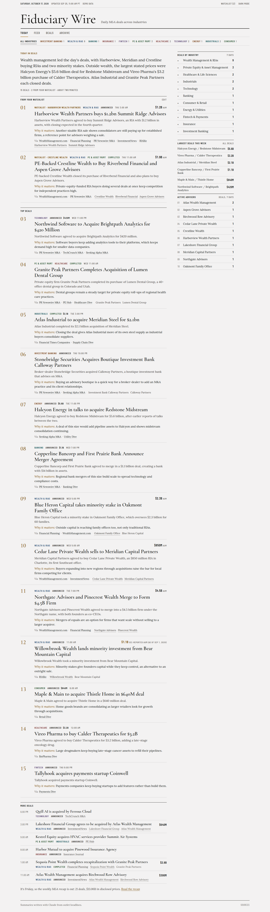
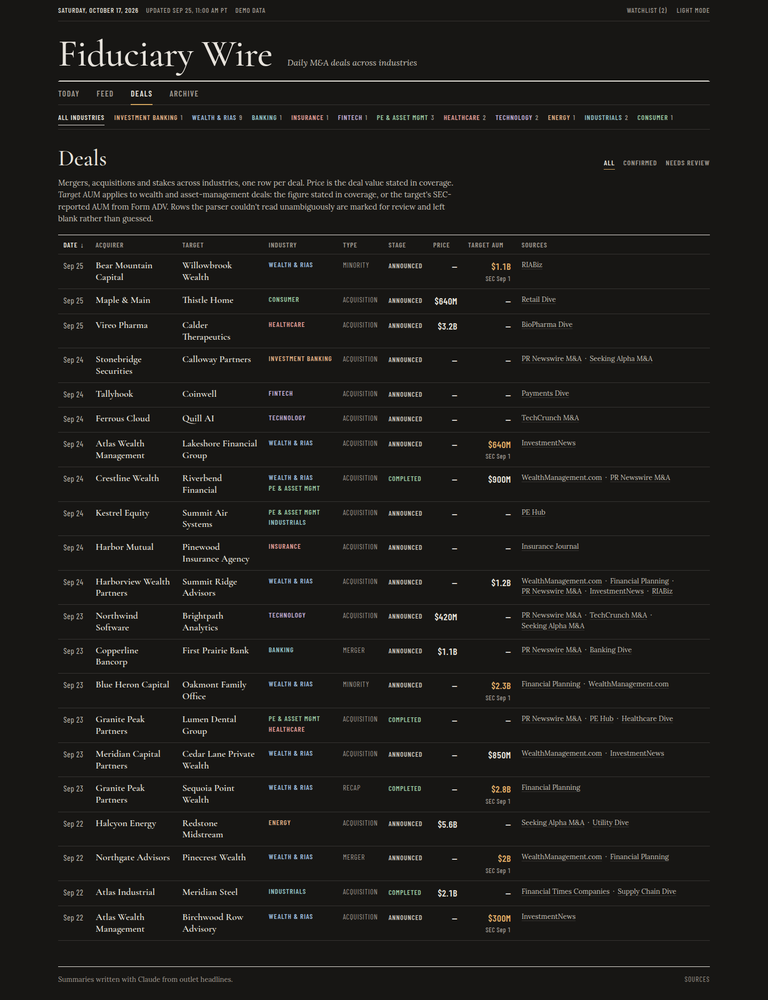
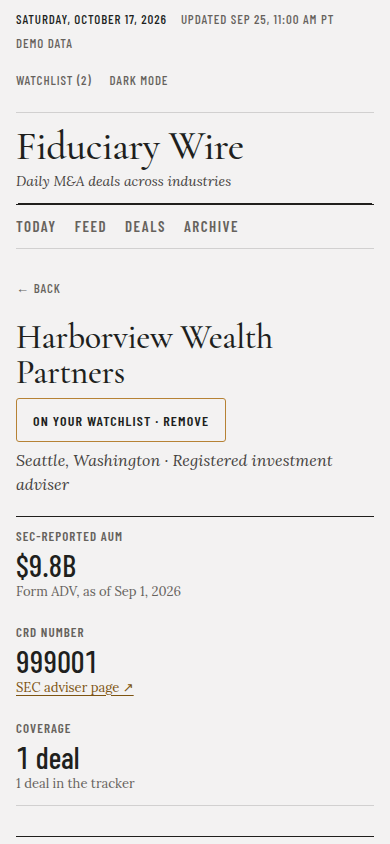
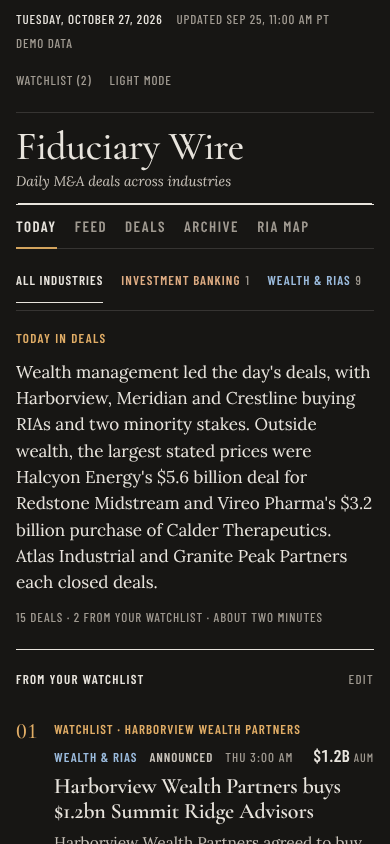

# Fiduciary Wire

Daily M&A deals across industries. Fiduciary Wire reads the PR Newswire M&A wire, deal feeds (Seeking Alpha
M&A, FT, PE Hub, TechCrunch) and industry trade press (wealth management, banking, payments, insurance,
healthcare, retail, energy, industrials), and keeps **only headlines that announce a deal**. General news is
dropped. It then:
- groups the same deal across outlets, even when they word it differently;
- tags each deal with its industries (Investment Banking, Wealth Management & RIAs, Banking, Technology, …)
  so the site can be filtered by industry;
- reads the acquirer, target, stage (rumored, bid, announced, completed, called off) and stated price;
- recognizes SEC-registered advisers and their AUM in wealth-management deals;
- has Claude write a short digest of the day's top deals.

It runs by itself on GitHub Actions and is served as a static site by Vercel. The project was earlier called
Wealth Wire, then Fiduciary Duty; the GitHub repository keeps its original name, `Wealth-Wire` (see RENAME.md).



| Deals | Firm page (mobile) | Today (mobile, dark) |
|---|---|---|
|  |  |  |

> The screenshots use the offline **demo dataset**: synthetic fixture feeds and a synthetic SEC file, marked
> "Demo data" in the dateline.

**What needs you:** [MANUAL-STEPS.md](MANUAL-STEPS.md) covers making the repo private and the optional
secrets for the Claude digest and the watchlist email. Each step is click-by-click. Without the secrets,
everything else runs and those features are skipped with a notice.

## How it works

```
GitHub Actions (weekdays every 3 hours 6:00–18:00 PT; weekends ~8:00 PT; or "Run workflow")
  1. restore state from the `live` branch        (database, digest archive)
  2. ingest: deal feeds, trade press, the M&A wire → keep deals only   (+ SEC adviser file, checked monthly)
  3. digest-input → Claude (claude-code-action) → digest-finalize (validate, archive, or fall back)
  4. build the static site + private state; privacy and data-contract checks
  5. force-push one orphan commit to `live`      (Vercel deploys it)
  6. optional watchlist email (Resend)
```

- **`main`** holds the source code only.
- **`live`** is one commit, replaced every run. It contains:
  - `site/`, the public website Vercel serves;
  - `state/`, private carry-over: the SQLite DB, digest archive, `SOURCES.md` and the firm-matching report;
  - `vercel.json`, which publishes only `site/`, adds `X-Robots-Tag: noindex` and routes `/firm/<slug>`.
- The public site holds only headlines, links, outlets, dates, industries, deal parties, stages and prices, firms, AUM and digest
  text. Publisher teasers and the database never leave `state/`: every build scans the output and fails if
  either shows up.

## Using the site

Four sections across the top, **Today · Feed · Deals · Archive**. Under them, on Today, Feed and Deals, a row of
**industry chips** filters everything to the industries you pick (pick several; the selection stays as you
switch tabs and is kept in the URL, e.g. `/?tab=mna&industry=Investment+Banking,Wealth+Management+%26+RIAs`).

- **Today** (`/`) is the digest: a short "Today in deals" opener, then the day's top deals, numbered, each with
  its industries, stage, price, a one-sentence summary and "Why it matters". Deals naming companies on your
  watchlist come first. The side column shows **Deals by industry** (7 days), **Largest deals this week** and
  **Active advisers** (SEC-registered advisers in this week's deals). When Claude's summaries aren't available,
  Today shows the ranked headlines with a note and a link to the last written digest.
- **Feed** (`?tab=feed`) lists every deal, newest first, grouped by day (Pacific time), with every outlet that
  covered it. Search headlines, companies and outlets (`/` jumps to the box); filter by outlet, date and region
  (HQ state of SEC-registered advisers), or show watchlist deals only.
- **Deals** (`?tab=mna`) is the tracker table: date, acquirer, target, industry, type, stage, price and target AUM
  (wealth deals: the figure in coverage, or the target's Form ADV AUM with its date), plus sources. Sort by any
  column; on a phone the rows stack. Rows the parser couldn't read are marked "Needs review" and left blank
  rather than guessed.
- **Firm pages** (`/firm/<slug>`) exist for SEC-registered advisers: location, SEC AUM, CRD with a link to the
  SEC adviser page, and every deal naming the firm.
- **Archive** (`?tab=archive`) lists past digests by week, and the **Friday M&A recaps**: deal count, deals per
  industry, disclosed price total, most active acquirers and a short Claude-written paragraph.
- **Sources** (footer link) shows each source's status and how many of its items were dropped as not deals.
- **Watchlist** (dateline): add companies with optional aliases; it lives only in your browser. Export/Import
  JSON moves it between browsers; the same file is the `WATCHLIST_JSON` email secret.

## Sources

Listed in `sources.yaml`; live status in the Sources tab and `state/SOURCES.md` on `live`.

| Kind | Sources | Notes |
|---|---|---|
| Press-release wire | PR Newswire M&A (all industries) | robots-checked; non-English translations and class-action notices dropped |
| All-industry deal feeds | Seeking Alpha M&A, Financial Times Companies, PE Hub, TechCrunch M&A | Seeking Alpha and FT are headline-only (gated) |
| Wealth management | WealthManagement.com, InvestmentNews, RIABiz, Financial Planning, AdvisorHub | AdvisorHub is gated and left off the public site |
| Other industries | Banking Dive, Payments Dive, Insurance Journal, Reinsurance News, BioPharma Dive, Healthcare Dive, Fierce Healthcare / Biotech / Pharma, Retail Dive, Utility Dive, Supply Chain Dive | each tags its deals with its industry |
| Disabled | ThinkAdvisor, FA Magazine, Citywire RIA (Google News search is disallowed by robots.txt), GlobeNewswire (robots.txt 403), SEC, FINRA, Kitces (no deals) | listed on the Sources page with the reason |
| SEC adviser data | Monthly Form ADV extract | Checked at most every 25 days; downloaded only when newer |

Every item from every source must pass the deal filter (`fiduciarywire/deals.py`); the Sources page shows how
many were dropped. `state/wire_stats.csv` on `live` records, per wire feed and run, what was fetched, too old,
dropped and kept.

Rules for every request:
- a User-Agent with the contact email;
- robots.txt respected;
- at least 2s between requests to the same host;
- 15s timeout, one retry;
- conditional GET.

It never logs in, never reads past a paywall, and never fetches article pages.

## Configuration

| File | Controls |
|---|---|
| `config.yaml` | contact email / User-Agent, timezone, politeness settings, clustering, `site:` (public-output options), `sec:` (SEC file checks) |
| `sources.yaml` | per source: `name`, `homepage`, `feed_url`, `kind` (`feed` / `google_news` / `wire`), `query`, `gated`, `listing_url`, `max_age_days`, `enabled`, `industry` |
| `industries.yaml` | industry tags: keywords and company names per industry (first match = primary) |
| `firm_aliases.yaml` | curated brand aliases ("Vanguard", "LPL", "Merrill") mapped to SEC names |
| `firm_stoplist.yaml` | capitalized phrases the fallback firm extractor must never report |
| `prompts/digest.md` | Claude's instructions for the digest and the weekly paragraph |

A push to `main` that changes any of these triggers a refresh. That run rebuilds the site but doesn't
rewrite the digest.

## The `/digest` command (Claude Code, optional)

The scheduled workflow writes the digest. If you have Claude Code and a local copy of the data, `/digest`
does the same locally:
1. it runs `digest-input`;
2. it follows `prompts/digest.md`;
3. it runs `digest-finalize`, which applies the same validation as the workflow.

Its permissions are limited to those commands and to reading and writing files under `_work/`.

## Run it on your computer (optional)

```bash
./run.sh                                  # makes .venv, installs, ingests once, serves http://localhost:8000
python -m fiduciarywire --help               # all commands (ingest, build-site, serve, digest-input, …)
```

Offline demo with the fixture data (no network):

```bash
export FIDUCIARYWIRE_HOME=demo FIDUCIARYWIRE_NOW=2026-09-25T18:00:00Z   # fixtures are dated around this instant
python -m fiduciarywire ingest --fixtures tests/fixtures/demo
python -m fiduciarywire serve
```

## Replacing the frontend

All rendering lives in **`frontend/`** (`index.html`, `app.js`, `style.css`, `favicon.svg`). The build copies
that folder verbatim into the site root and writes the data next to it under `/data/`. A new design only has
to:

1. **Read the data.** Load the JSON files documented in [DATA-CONTRACT.md](DATA-CONTRACT.md) (schemas in
   `schemas/`) with `fetch("/data/…")`. There is no API.
2. **Handle the routes:** `/` and `/firm/<slug>`. Vercel rewrites `/firm/*` to `/index.html`, and the local
   server does the same. Query-string views (`?tab=…`) are up to you.
3. **Keep the watchlist in the browser.** Store it in `localStorage` and match it against `clusters.json`,
   using `firms/index.json` for SEC names. The current `app.js` shows the matching rules.
4. **Keep the footer note:** "Summaries written with Claude from outlet headlines." It is also available as
   `meta.footer_note`.

Replace the files in `frontend/` (any static output works; if you use a build tool, commit its output into
`frontend/`). Nothing in `fiduciarywire/`, `schemas/` or the workflow needs to change.

**Test locally against real data:**

```bash
python -m fiduciarywire state fetch _prev && python -m fiduciarywire state restore _prev   # pull the live DB
python -m fiduciarywire serve            # builds site/data from it and serves http://localhost:8000
```

Or run fully offline on the demo data (see above). `python -m pytest tests/test_site.py` checks that the
generated data still matches the contract.

## Development

```bash
pip install -r requirements.txt
python -m pytest                   # 352 tests, no network (fixture feeds + httpx MockTransport)
python scripts/screenshots.py      # Playwright: 16 views × 1440/390 × light/dark, interactions, tap targets; fails on console errors
python scripts/make_fixtures.py    # regenerate the offline fixture sites
python -m fiduciarywire eval-firms    # firm-matching precision/recall on the 75 labeled headlines
```

- Phase 2 plan: [PLAN-PHASE2.md](PLAN-PHASE2.md).
- Every judgment call: [DECISIONS.md](DECISIONS.md).
- Results: [AUDIT-PHASE2.md](AUDIT-PHASE2.md), plus the phase 1 [AUDIT.md](AUDIT.md).
- Data contract: [DATA-CONTRACT.md](DATA-CONTRACT.md).

## Known limitations

- **Deal detection reads headlines, not articles.** It keeps a headline only when it parses as a deal with a
  named party. On 1,314 labeled real headlines it agrees with every label but one, but that set is also what
  it was built on: new phrasings will be missed or, less often, let through. Roundups ("Deals & Moves: …"),
  deals described only in the body, and partnership-style wording ("join forces") are missed.
- **Coverage is what public feeds allow.** Google News search, GlobeNewswire, WSJ and PitchBook disallow
  automated readers, so they aren't used. Most feeds list only their latest 10–20 items, so a burst of
  releases between two runs (3 hours apart on weekdays) can push some out.
- **Industries are keyword tags.** A deal can carry several; a company the keyword list doesn't know lands in
  "Other" unless the outlet itself is single-industry.
- **SEC adviser matching is heuristic.** On 133 real headlines it had never seen (blind set B, AUDIT-PHASE2.md §1),
  against the real SEC file, it scored precision 0.90 and recall 0.83 before the fixes those errors prompted.
  Expect roughly that on new headlines, not the higher in-sample scores the tests pin. Brands that are ordinary
  words ("Horizon") or firms that aren't SEC-registered advisers (broker-dealers, Prudential) are missed. The same text as a real adviser's name
  (Luma) can mismatch. Unmatched capitalized firm names still come from a fallback extractor and are marked
  unverified, with no firm page.
- **SEC data is monthly.** AUM is the regulatory AUM from the latest file and is labeled with its date.
- **The Claude digest and the email only run once you add their secrets.** Neither was exercised live
  before handing over; see AUDIT-PHASE2.md.
- **The schedule drifts an hour in winter.** GitHub cron is UTC, anchored to Pacific Daylight Time.
- **Clustering is fuzzy title matching.** Two different stories that differ only by a proper noun can
  merge. Stories more than 72h apart never merge.
- **The watchlist is per browser.** Use Export/Import to move it; the email uses its own copy in
  `WATCHLIST_JSON`.
